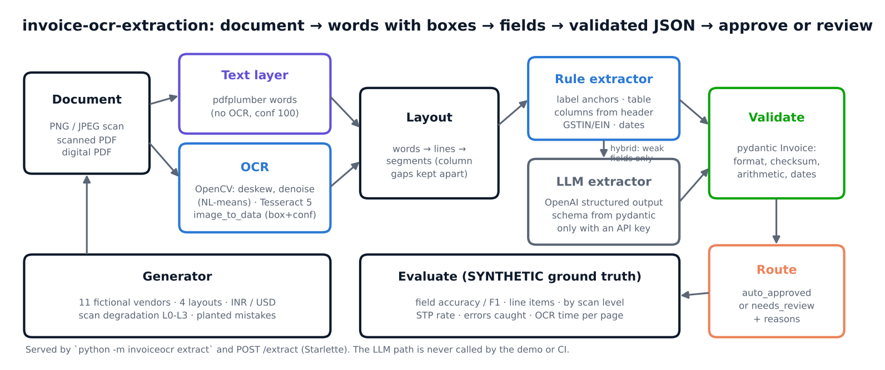
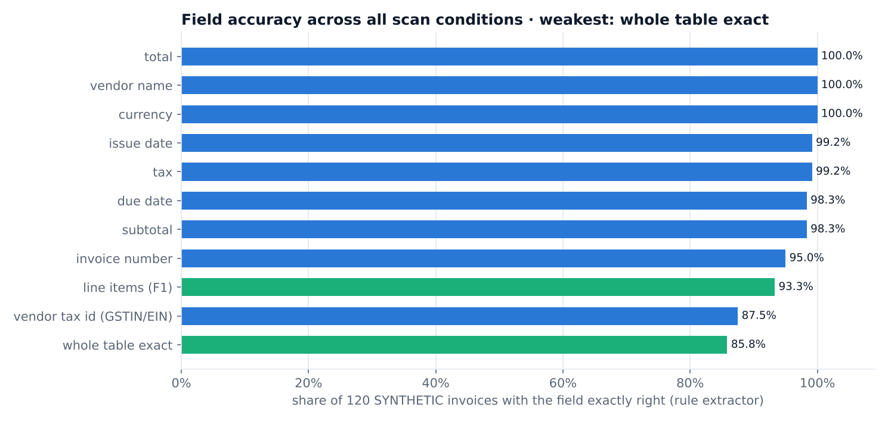
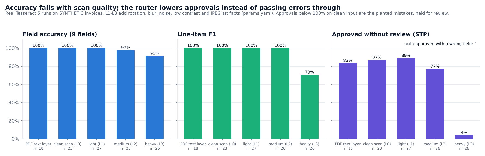
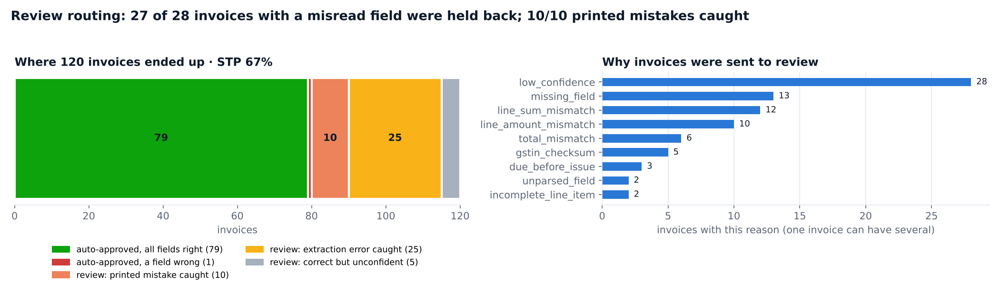
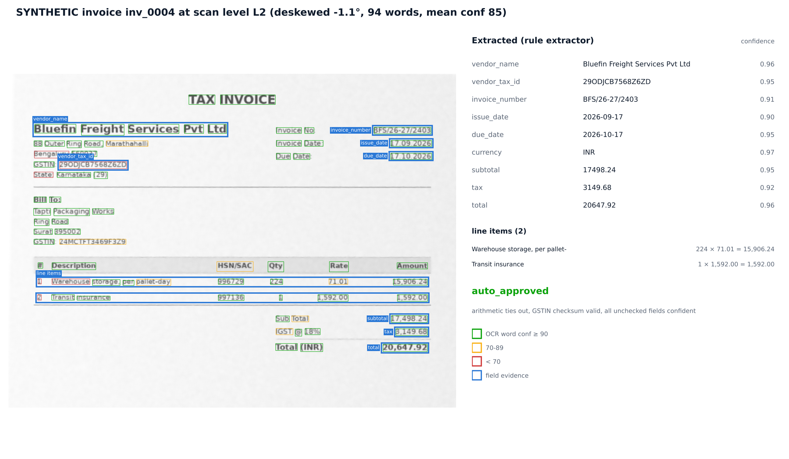
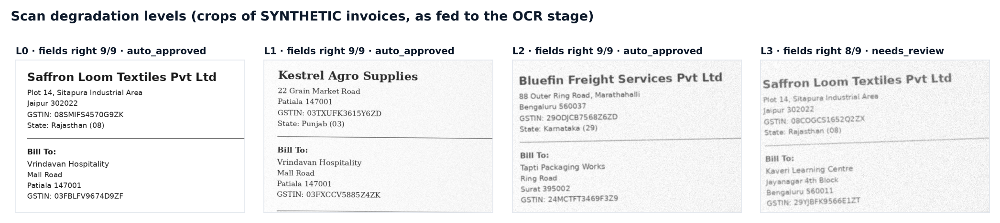

# Invoice OCR Extraction

[](https://github.com/vishavjit-singh/invoice-ocr-extraction/actions/workflows/ci.yml)


Turns invoice scans and PDFs into validated JSON, and decides which invoices can be booked without a person
looking at them:

- **OCR** with OpenCV preprocessing (deskew, denoise) and Tesseract 5 word boxes with confidences. Digital PDFs
  skip OCR and use their text layer
- **Layout-aware extraction**: label anchors such as "Invoice No:" or "Balance due" (fuzzy-matched, so OCR slips
  still count), table columns taken from the header row, GSTIN and EIN detection
- An optional **OpenAI fallback** with a JSON schema generated from the pydantic model. The `hybrid` extractor
  asks it only for the fields the rules could not read well
- **Pydantic v2 validation**: tax-id format and GSTIN check character, ISO dates, and cross-field arithmetic
  (line items → subtotal, subtotal + tax = total, due date after issue)
- **Review routing**: `auto_approved`, or `needs_review` with machine-readable reasons
- **Evaluation** against ground truth: field accuracy and F1, line items, results per scan quality,
  straight-through processing (STP) rate, and errors caught

All invoices are **SYNTHETIC**: 11 fictional vendors, 4 layouts (2 Indian GST, 2 US), INR and USD, with controlled
scan damage and a few deliberate printing mistakes. Each page has a footer saying so. The OCR, however, is real:
every number below comes from Tesseract 5.3.4 running on those images.



## Why this project

| Problem with invoice capture | How this repo handles it |
|---|---|
| OCR returns a bag of words; the same label sits in a different place on every vendor's layout | Words are rebuilt into lines and *segments* (column gaps kept apart). Values are read next to their label, and table cells are assigned by the header's column edges |
| Scans are skewed, noisy and low-contrast | A projection-profile deskew (mean error 0.044° on this set), denoising only on pages that are actually noisy, then Tesseract `image_to_data` |
| OCR confuses `O/0`, `S/5`, `]/J` and drops decimal points | Position-aware repairs: GSTIN characters are forced into shape position by position, and amounts are re-pointed. Every repair lowers confidence and is listed in `notes` |
| A confident OCR read can still be wrong | Cross-checks decide what to trust: line items must sum to the subtotal, subtotal + tax must equal the total, and the GSTIN check character must validate. Only fields nothing can cross-check (vendor name, invoice number, dates, EIN) need OCR confidence ≥ 0.70 |
| Vendors make mistakes too | The same rules catch printed errors: a wrong total, a subtotal that does not match its lines, a due date before the issue date, an invalid GSTIN |
| LLMs are expensive and can invent values | Rules run first. The LLM is called only for weak fields, with a strict schema. Each LLM value is checked against the OCR text and gets a low score if it is not there |
| "How good is it?" | `eval` scores every field against ground truth, per scan level, and reports how many errors reached auto-approval |

## Results from the demo run

`make demo` generates 120 SYNTHETIC invoices (90 images, 12 scanned PDFs, 18 digital PDFs; 10 printed with a
deliberate mistake), runs OCR → rule extraction → validation → routing on all of them, and draws the charts below.
It took 71 s on 2 CPUs (OCR 54 s with 2 Tesseract workers). Scan damage by level (rotation, blur, noise, contrast,
JPEG quality, downscale) is set in [`params.yaml`](params.yaml).

**Per field**, rule extractor, all scan conditions together:



**By scan quality.** Digital PDFs, clean scans and light damage come out fully right. Medium damage costs some
GSTINs and invoice numbers, and the heavy level breaks tables and tax ids. STP falls with it, from 89% at L1 to 4%
at L3:



**Routing.** 80 of 120 invoices were approved automatically. 27 of the 28 invoices with a misread field were held
back, and all 10 printed mistakes were caught with the right reason. One error got through: an invoice number with
a zero missing (`LOG/8091` for `LOG/08091`), read at confidence 0.74, just above the 0.70 threshold. Nothing
cross-checks invoice numbers, which is the main limit of this approach:



| Metric (120 SYNTHETIC invoices, rule extractor) | Value |
|---|---|
| All 9 fields + every line item exactly right | 76.7% |
| Field accuracy: vendor name / total / currency | 100% / 100% / 100% |
| Field accuracy: issue date / tax / subtotal / due date | 99.2% / 99.2% / 98.3% / 98.3% |
| Field accuracy: invoice number / vendor tax id | 95.0% / 87.5% |
| Line items (365 in ground truth): precision / recall / F1 | 0.952 / 0.915 / 0.933 · whole table exact on 85.8% |
| Straight-through processing (auto-approved) | 66.7% (80 invoices), of which 98.75% fully correct (79/80) |
| Invoices with a misread field sent to review | 27 of 28 (96.4%) |
| Correct, clean invoices sent to review anyway | 5 of 84 (6.0%) |
| Printed mistakes caught with the right rule | 10 of 10 (4 totals, 2 subtotals, 3 due dates, 1 GSTIN) |
| Tesseract time per page (2 workers) | mean 1.02 s · median 1.09 s · p95 1.44 s; PDF text layer 0.03 s |
| Invoices the `hybrid` extractor would send to an LLM | 71 of 120 (59.2%), 2.0 fields each on average |

**The review threshold is a business knob.** The same extractions routed at other thresholds:

| Min. confidence for unchecked fields | 0.5 | 0.6 | **0.7** (default) | 0.8 | 0.9 |
|---|---|---|---|---|---|
| STP rate | 68.3% | 66.7% | **66.7%** | 61.7% | 39.2% |
| Auto-approved with a wrong field | 1 | 1 | **1** | 0 | 0 |

**What one page looks like.** Word boxes are coloured by Tesseract confidence, and blue boxes show the words each
field came from. Note the GSTIN: Tesseract read it at under 70 confidence, but the check character validates, so it
is trusted:





> Denoising choice, measured on the same 120 invoices: with `denoise: median` instead of the default non-local
> means, Tesseract took 0.58 s per page instead of 1.02 s. Fully-correct invoices fell from 76.7% to 72.5% and STP
> from 66.7% to 60.8%, while auto-approved errors went from 1 to 0. Every number above is in
> `outputs/metrics.json` after `make demo`. All data is synthetic, so these numbers describe this generator and
> are not a benchmark for real invoices.

## Quickstart

```bash
sudo apt-get install tesseract-ocr          # macOS: brew install tesseract
git clone https://github.com/vishavjit-singh/invoice-ocr-extraction.git
cd invoice-ocr-extraction
python -m venv .venv && source .venv/bin/activate
make install
make demo        # generate → eval → report (about a minute and a half on 2 CPUs)
make test        # 48 tests
make serve       # API on http://127.0.0.1:8000
```

## Usage

### CLI

```bash
python -m invoiceocr generate --n 200            # SYNTHETIC invoices + ground truth in data/
python -m invoiceocr extract data/invoices/inv_0023.pdf
python -m invoiceocr extract scan.jpg --overlay overlay.png   # also draw boxes and fields
python -m invoiceocr extract scan.jpg --extractor hybrid      # needs OPENAI_API_KEY
python -m invoiceocr eval                        # score everything → outputs/metrics.json, results.csv
python -m invoiceocr report                      # redraw docs/images
```

A digital PDF from the demo set (output shortened):

```json
{
  "status": "auto_approved",
  "reasons": [],
  "invoice": {
    "vendor_name": "Kestrel Agro Supplies",
    "vendor_tax_id": "03AVECK9307O5ZY",
    "invoice_number": "KAS-04933",
    "issue_date": "2025-08-24",
    "due_date": null,
    "currency": "INR",
    "line_items": [
      {"description": "Mulching film roll", "quantity": 3.0, "unit_price": 3247.68, "amount": 9743.04},
      ...
    ],
    "subtotal": 77940.51, "tax": 9352.86, "total": 87293.37
  },
  "confidence": {"vendor_tax_id": 1.0, "invoice_number": 1.0, "total": 1.0, ...},
  "extractor": "rules",
  "ocr": {"source": "pdf_text", "seconds": 0.064, "skew_deg": 0.0, "mean_conf": 100.0, "words": 104}
}
```

(`due_date` is null because that invoice says "Due on receipt".) A heavily damaged scan (L3) from the same run:

```json
{
  "status": "needs_review",
  "reasons": [
    {"code": "line_amount_mismatch", "field": null, "message": "line 1: 24 × 20.43 ≠ 487.92"},
    {"code": "line_sum_mismatch", "field": null, "message": "line items sum to 1591.08, subtotal is 1682.52"},
    {"code": "low_confidence", "field": "vendor_tax_id", "message": "vendor_tax_id read with confidence 0.58"},
    {"code": "low_confidence", "field": "total", "message": "total read with confidence 0.30"}
  ],
  "ocr": {"source": "tesseract", "seconds": 1.328, "skew_deg": -2.4, "mean_conf": 78.1, "words": 99}
}
```

### API

```bash
curl -s localhost:8000/health        # {"status": "ok", "tesseract": "5.3.4", "llm_available": false}
curl -s localhost:8000/schema        # JSON schema of a validated Invoice
curl -s -F file=@data/invoices/inv_0023.pdf localhost:8000/extract          # multipart upload
curl -s --data-binary @scan.png -H 'content-type: image/png' localhost:8000/extract   # or a raw body
curl -s -F file=@scan.png 'localhost:8000/extract?extractor=hybrid'         # with OPENAI_API_KEY set
```

The response is the same JSON as the CLI. Errors come back as `{"error": {"code", "message"}}`: `400` for an empty
body, an unknown extractor or the LLM without a key, `413` over 10 MB, `415` for something that is not a PDF or an
image (checked by magic bytes, not by file name), and `422` for a corrupt file. `docker compose up --build` serves
the API from an image with Tesseract installed.

## Project structure

```
├── params.yaml                    # dataset size, scan damage per level, OCR settings, review threshold
├── src/invoiceocr/
│   ├── generate.py                # SYNTHETIC vendors, 4 layouts, PNG/JPEG/PDF rendering, scan damage, mistakes
│   ├── ocr.py                     # pdfplumber text layer · OpenCV deskew/denoise · Tesseract words · cache
│   ├── layout.py                  # words → lines → segments
│   ├── normalize.py               # amounts, dates, GSTIN/EIN, fuzzy labels (with repair flags)
│   ├── extract/
│   │   ├── rules.py               # label anchors, header-driven table reading, headerless fallback
│   │   ├── llm.py                 # OpenAI structured output (urllib), strict schema, grounding check
│   │   └── hybrid.py              # rules first, LLM for weak fields only
│   ├── schema.py                  # InvoiceDraft / Invoice (pydantic v2) + cross-field rules
│   ├── routing.py                 # auto_approved vs needs_review, with reasons
│   ├── evaluate.py                # scores vs ground truth → outputs/metrics.json, results.csv
│   ├── report.py                  # the charts in docs/images
│   ├── api.py · cli.py
├── tests/                         # 48 tests; fixtures/ holds a hand-written Chat Completions response
├── Dockerfile · docker-compose.yml · Makefile
└── .github/workflows/ci.yml       # lint + tests + demo on 3.11/3.12 · Docker build + API smoke test
```

## Testing

```bash
make lint && make test
```

- **Extraction on every layout:** for all 11 vendors and 4 layouts, the digital PDF comes out exactly right,
  every field and every line item. The vendor's GSTIN is not confused with the buyer's. When the table header is
  unreadable, rows are still read by position
- **OCR:** deskew recovers a known 2.4° rotation to within 0.3°. The noise estimate separates clean pages from
  noisy ones. Tesseract reads a clean rendered invoice, and the second call is served from the cache
- **Parsing and repairs:** Indian digit grouping, currency prefixes, lost and misread decimal points, day-first
  vs month-first dates, misread month names, GSTIN `]`→J and `2Z`→Z slips, an EIN with its hyphen lost. Each
  repair must say it repaired, and an unreadable date is never guessed
- **Validation and routing:** each cross-field rule fires on its own error. A bad GSTIN check character is its
  own error type. Low confidence is ignored for arithmetic-verified fields but not for the invoice number. Missing
  fields and unlabelled dates send an invoice to review
- **LLM and hybrid, offline:** the generated schema meets strict structured-output rules. A fake transport
  returns a hand-written response, which is parsed and grounded, and an invented value scores low. Refusals and
  off-schema answers raise. The hybrid asks only for weak fields, makes no call when nothing is weak, and falls
  back to the rule result without a key or when the call fails
- **API** (through a small in-repo ASGI client, no httpx needed): health, schema, multipart PDF upload, and every
  error status
- **End to end:** a 16-invoice set is generated, OCR'd, extracted and scored, the charts are rendered, and the CLI
  writes JSON and an overlay

## Limitations and roadmap

- **Synthetic data.** Eleven vendors and four layouts are far fewer than a real accounts-payable inbox. The
  layouts are regular, with single-line descriptions and one page each. The rule extractor was developed against
  this generator, so its accuracy here overstates what it would do on unseen layouts. The scan damage is
  simulated, not photographed.
- **The LLM path was not run against the real API.** It was tested only with a fake transport and a hand-written
  response in the Chat Completions shape. `make demo` and CI never call it, and the "would send to an LLM" figure
  counts calls; it says nothing about what the LLM would get right. Run
  `python -m invoiceocr extract FILE --extractor hybrid` with `OPENAI_API_KEY` set to try it.
- **What did not run locally.** FastAPI could not be installed in the environment this was built in, so the API
  uses Starlette, the ASGI toolkit FastAPI is built on, and swapping later only touches `api.py`. The
  Docker image (with `apt install tesseract-ocr`) and the GitHub Actions workflow were not run locally; they run
  first in CI. Tesseract, OpenCV, pdfplumber and the full demo did run locally.
- **Unchecked fields are the weak spot.** The one wrong approval was an invoice number, the kind of field nothing
  cross-checks. A vendor master (known GSTIN → name and invoice-number pattern) and duplicate-invoice detection
  would close most of that gap.
- **Not handled yet:** multi-page invoices, wrapped line descriptions on scans, handwritten notes, stamps, and
  languages other than English.
- **Next:** re-OCR of low-confidence table cells with a digits-only Tesseract pass, a vendor master lookup, a
  measured LLM run on the same 120 invoices, and a page-classification step before extraction.

## Author

**Vishavjit Singh Saini**, Data Engineer
[Portfolio](https://vishavjit-singh.pages.dev/) · [LinkedIn](https://www.linkedin.com/in/vishavjit-singh-7011211ab/) · [GitHub](https://github.com/vishavjit-singh)

## License

[MIT](LICENSE)
